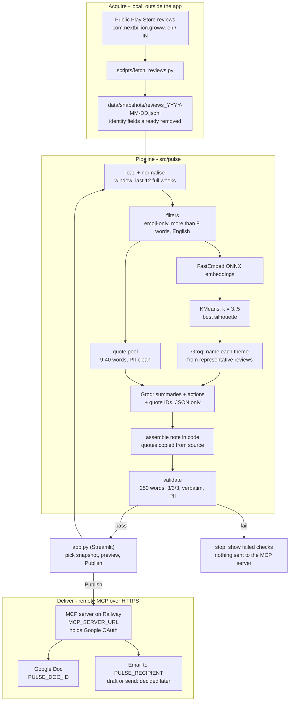

# Architecture

Design for the Groww Weekly Review Pulse described in [`problemStatement.md`](./problemStatement.md). Nothing is built yet. This document fixes the shape of the system before `implementation-plan.md` is written.

## What the system is

A Python pipeline with a Streamlit front end. It takes a snapshot of public Google Play reviews for `com.nextbillion.groww`, filters them, clusters them into at most 5 themes, and writes a one-page note of 250 words or fewer. The note has the top 3 themes, 3 verbatim quotes and 3 action ideas. After a preview and a Publish click, the agent delivers the note through a remote MCP server to a Google Doc and to an email address.

Three rules shape every component:

1. **Code owns the facts, the LLM owns the wording.** Counts, ratings, dates and quotes come from the data. The LLM names themes and drafts summary lines and actions. It picks quotes by ID and never types them out.
2. **Every artifact is checked before it leaves the machine.** Word count, the 3/3/3 structure, verbatim quotes and PII are checked in Python. A failed check stops the run before anything is sent to the MCP server.
3. **Google is reached only through the MCP server.** This agent is an MCP client only. It connects to a separately built and deployed MCP server at `MCP_SERVER_URL`. The MCP server holds the Google OAuth login; the agent holds no Google credentials. There is no `googleapiclient` import in `src/`.

Hosting follows the Nutrition RAG project: Streamlit Community Cloud, deployed from GitHub, with secrets in Streamlit's secrets store.

## End-to-end flow



The pipeline is a plain function, `run_pulse(snapshot, week_ending) -> PulseResult`. The Streamlit app and `scripts/run_pulse.py` both call it. Delivery is a separate step, `publish(result)`, so a preview never contacts the MCP server.

## Acquiring reviews

### Source

Google Play only. The official Play Developer Reporting API and Play Console exports are available only to the app's owner, and we are not Groww. That leaves the public listing page, which anyone can read without signing in.

`scripts/fetch_reviews.py` uses the [`google-play-scraper`](https://pypi.org/project/google-play-scraper/) package. It reads the same public, logged-out review feed the Play Store page shows, with `lang="en"`, `country="in"`, sorted newest first, and paging until reviews are older than the window. It runs on a laptop, about once a week, with a delay between pages. It does not log in, rotate IPs or get around rate limits. This is the chosen source (see **Decisions**). The pipeline itself only reads the snapshot file, so it does not depend on how the snapshot was made.

The deployed Streamlit app never contacts the Play Store. It reads committed snapshots or a file uploaded in the UI. This keeps scraping off a shared cloud IP and makes every run repeatable from a fixed input.

### Snapshot schema

Identity fields are removed at fetch time, before anything touches the disk.

| Field | Type | Source | Notes |
| --- | --- | --- | --- |
| `id` | str | SHA-256 of Play `reviewId`, first 12 hex chars | Internal only. Used for quote lookup. Never printed in artifacts |
| `rating` | int 1-5 | `score` | |
| `title` | str or null | not provided | Play reviews no longer have titles. Kept for schema parity; always null from this source |
| `text` | str | `content` | Stored exactly as received. Never edited |
| `date` | ISO date | `at` | Converted to Asia/Kolkata before truncating to a date |
| `app_version` | str or null | `appVersion` | Optional context for themes such as "after the last update" |
| `thumbs_up` | int | `thumbsUpCount` | Used to break ties when ranking quote candidates |

Dropped at fetch and never stored: `userName`, `userImage`, raw `reviewId`, `replyContent`, `repliedAt` (Groww's replies are not user voice).

## Filtering

`src/pulse/filters.py`. Each rule is a pure function on one review. The pipeline records how many reviews each rule removed, and the UI shows that count.

| Order | Rule | Definition |
| --- | --- | --- |
| 1 | Window | `date` is within the last `WINDOW_WEEKS` full weeks (Monday to Sunday, IST) up to `week_ending`. Default 12, allowed 8 to 12 |
| 2 | Emoji-only | No letter or digit is left after ignoring emoji (per the `emoji` package), whitespace and punctuation. Example: `👍👍👍`, `🔥🔥 !!!`. **Every other review is kept unchanged. Emoji inside kept reviews are not stripped.** |
| 3 | More than 8 words | At least 9 word tokens. A word is a run of letters or digits (`\w+`), so emoji and punctuation do not count as words |
| 4 | English | [`lingua`](https://pypi.org/project/lingua-language-detector/) detector over English, Hindi and the main Indian languages. Keep if English is the top language with confidence of at least `MIN_ENGLISH_CONFIDENCE` (0.5) |

Emoji-only reviews would also fail rule 3. Rule 2 still runs first so the counts show why each review was dropped.

Known effect of rule 4: Hinglish (Hindi written in Latin script, such as "app bahut slow hai") is common in Groww reviews. It usually scores low for English and gets dropped. That matches the brief's "remove non-English reviews". The run report shows how many were dropped so the team knows what is missing.

The filtered set is stored with the run. It has the same fields as the snapshot.

## Clustering into themes

`src/pulse/cluster.py`. Clustering runs locally. Only small samples go to the LLM.

Why not have the LLM cluster everything: a 12-week window can hold a few thousand qualifying reviews. That is hundreds of thousands of tokens, far above the Groq free plan (8,000 tokens per minute). Embedding locally costs nothing per run, and the result is the same every time.

1. **Embed** each review's `text` with FastEmbed (ONNX, no PyTorch), model `BAAI/bge-small-en-v1.5`. Reviews are short, so its 512-token window is enough. Same runtime as the Nutrition RAG project, so the memory footprint is known to fit Streamlit Cloud.
2. **Cluster** with scikit-learn `KMeans` for each `k` in 3, 4 and 5, fixed `random_state`. Keep the `k` with the best silhouette score. The cap of 5 is enforced here, so the LLM never sees more than 5 groups.
3. **Representatives**: for each cluster, the `REPS_PER_THEME` (12) reviews closest to the centroid, plus summary numbers: size, share of the filtered total, average rating, share of 1-2 star reviews.
4. **Label**: one Groq call per cluster with only its representatives. It returns JSON `{"name": "...", "summary": "..."}`. The name has at most 4 words and the summary at most 20. If two clusters get near-identical names, they are listed separately, not merged. Merging would change counts the LLM cannot see.
5. **Rank** themes by review count (cluster size). Average rating breaks ties, lowest first. The top 3 go into the note. All themes (up to 5) appear in the run report.

The fixed seed and a pinned embedding model make two runs on the same snapshot produce the same themes and counts. Only the LLM's wording changes between runs.

## Writing the note

`src/pulse/note.py`.

### Quote pool

Quote candidates are filtered reviews that:

- belong to one of the top 3 themes,
- are 9 to 40 words long (verbatim quotes cannot be cut, so long ones blow the 250-word budget),
- pass the PII scan (below).

For each top theme, the 8 candidates nearest the centroid are ranked by `thumbs_up`. They go to the LLM as `{id, theme, rating, text}`.

### Compose call

One Groq call gets the top 3 themes (name, summary, numbers) and the quote pool. It must return JSON only:

```json
{
  "themes": [{"rank": 1, "line": "..."}, {"rank": 2, "line": "..."}, {"rank": 3, "line": "..."}],
  "quote_ids": ["a1b2c3d4e5f6", "...", "..."],
  "actions": [{"theme_rank": 1, "text": "..."}, {"theme_rank": 2, "text": "..."}, {"theme_rank": 3, "text": "..."}]
}
```

The prompt asks for one quote per theme where possible, actions that a product, growth or support team can act on, and no numbers that were not in the input.

### Assembly

Code, not the LLM, builds the final text. Quote text is copied from the filtered set by `id`, so the wording cannot drift. Template:

```text
Groww Review Pulse - week of 12 Oct 2026
{N} Play Store reviews, {start} to {end}. Average rating {x.x}.

Top themes
1. {name} ({share}% of reviews, avg {r}★): {line}
2. ...
3. ...

What users said
"{verbatim text}" ({rating}★)
"..."
"..."

What to do next
1. {action}  [{theme name}]
2. ...
3. ...
```

Only the star rating goes next to a quote. The date and app version are left off so a quote cannot be matched back to a reviewer.

### Validation

`validate(note, result) -> list[Failure]`. All checks must pass before publishing.

| Check | Rule |
| --- | --- |
| Length | At most 250 words, counted with `\w+` over the whole note including headings and quotes |
| Structure | Exactly 3 themes, 3 quotes, 3 actions. Each action references one of the top 3 themes |
| Verbatim | Each quote string is an exact substring of a review `text` in the filtered set |
| Distinct quotes | The 3 quote IDs are different |
| Grounded numbers | Every number in the note appears in the computed summary numbers or the template |
| PII | The PII scan finds nothing in the full note |

If a check fails, the compose call is retried once, with the failure list added to the prompt. If it fails again, the run stops with the failures shown in the UI. Nothing is sent to the MCP server.

## PII handling

The brief bans reviewer identity from every artifact. There are two layers.

**Structural.** Identity fields never enter the snapshot (see the schema above). Run artifacts and the note contain only the hashed `id` internally, and the note contains no ID at all.

**Free-text.** Reviewers sometimes type personal details into their review. `src/pulse/pii.py` scans for:

- email addresses
- Indian phone numbers (10 digits, optional `+91` or `0`, with or without spaces and dashes)
- PAN (`[A-Z]{5}[0-9]{4}[A-Z]`)
- UPI IDs (`name@bank` style handles)
- long digit runs (account, folio, demat, order or ticket numbers, 8 or more digits)
- `@handles` and self-identification such as "my name is ..."

A review that matches anything is never used as a quote (see **Decisions**). Because quotes must stay verbatim, a quote is never redacted: it is skipped. Such reviews still count toward theme sizes and may appear among the representatives sent to Groq. The same scan runs on the final note as the last check.

## Delivery through MCP

`src/pulse/delivery/`.

### Server

The MCP server is a separate project, built and deployed on Railway by the owner. It is not part of this repository and is not installed or started by this app. It has its own public HTTPS URL, stored in `MCP_SERVER_URL`.

The server holds the Google OAuth login and makes all Google Docs and email calls. This agent holds no Google credentials, OAuth client, refresh token or Google account setting.

### Client

`src/pulse/delivery/mcp_client.py` uses the official `mcp` Python SDK to open a remote session to `MCP_SERVER_URL` over HTTPS. The app calls tools directly and deterministically. The LLM is never given the tools, so it cannot create, edit or send anything on its own.

Tool names, arguments and response shapes are not fixed in this document. They are read from the MCP server's GitHub README in the phase that connects the agent to the server, and recorded there.

### Publish

`publish(result)`:

1. Write the final note to the Google Doc identified by `PULSE_DOC_ID`, through the MCP server.
2. Send the note and the Doc link through the MCP server to the address in `PULSE_RECIPIENT`. Whether this creates a draft or sends the email is decided in the connect phase, from what the MCP server supports.
3. Return the Doc link and the email confirmation to the UI.

If step 1 succeeds and step 2 fails, the UI shows the Doc link and a "Retry email" button. That reruns step 2 only.

## Streamlit app

`app.py`, the only UI.

**Layout.**

- Sidebar: snapshot picker (committed files under `data/snapshots/`) or file upload, `week_ending` (defaults to the last full week), window weeks (8 to 12).
- **Generate preview**: runs `run_pulse`. Shows the note, its word count, the checks, a filter funnel (reviews in, dropped per rule, kept), and every theme with size, average rating and representatives.
- **Publish**: only enabled when every check has passed. Calls `publish(result)`. Shows the Doc link and confirms the email step.

There is no scheduler on Streamlit Cloud. The weekly cadence is someone opening the app and clicking twice. The CLI (`scripts/run_pulse.py --publish`) runs the same functions, so a cron job (for example GitHub Actions) can be added later without changing the pipeline.

## Run artifacts

Each run writes to `data/runs/{week_ending}/`. Locally this folder is gitignored. On Streamlit Cloud it is temporary, and the UI offers a zip download.

| File | Contents |
| --- | --- |
| `filtered.jsonl` | Reviews that passed every filter, in snapshot schema |
| `funnel.json` | Count in, count removed by each rule, count kept |
| `themes.json` | All themes: name, summary, size, share, average rating, representative IDs, chosen `k` and silhouette score |
| `note.md` | The final note |
| `checks.json` | Each validation check and its result |
| `publish.json` | Doc ID and link, email confirmation, timestamps. Written only after publishing |

None of these contain reviewer identity. The `id` values are one-way hashes.

## Proposed layout

```text
Groww_Pulse/
├── app.py                       # Streamlit UI
├── src/pulse/
│   ├── config.py                # defaults + secrets lookup (env first, then st.secrets)
│   ├── models.py                # Review, Theme, PulseResult dataclasses
│   ├── snapshot.py              # load + validate JSONL/CSV snapshots
│   ├── filters.py
│   ├── pii.py
│   ├── cluster.py               # embed, KMeans, representatives
│   ├── themes.py                # Groq theme labelling
│   ├── note.py                  # quote pool, compose, assemble, validate
│   ├── llm.py                   # Groq client, JSON-only calls, retry
│   ├── pipeline.py              # run_pulse()
│   └── delivery/
│       ├── mcp_client.py        # remote session to MCP_SERVER_URL
│       └── publish.py           # publish()
├── scripts/
│   ├── fetch_reviews.py         # public Play reviews -> snapshot (local only)
│   └── run_pulse.py             # CLI: preview, or --publish
├── data/
│   ├── snapshots/               # committed, PII-free
│   └── runs/                    # gitignored
├── tests/
├── docs/
├── requirements.txt
├── .env.example
└── .streamlit/
    ├── config.toml
    └── secrets.toml.example
```

## Configuration defaults

Planned for `src/pulse/config.py`.

| Setting | Default |
| --- | --- |
| `APP_ID` | `com.nextbillion.groww` |
| `PLAY_LANG` / `PLAY_COUNTRY` | `en` / `in` |
| `WINDOW_WEEKS` | `12` (allowed 8 to 12) |
| `TIMEZONE` | `Asia/Kolkata` |
| `MIN_WORDS` | `9` (that is, more than 8) |
| `MIN_ENGLISH_CONFIDENCE` | `0.5` |
| `EMBEDDING_MODEL` | `BAAI/bge-small-en-v1.5` |
| `K_RANGE` | `3..5` |
| `RANDOM_STATE` | `42` |
| `REPS_PER_THEME` | `12` |
| `QUOTE_WORDS` | `9..40` |
| `MAX_NOTE_WORDS` | `250` |
| `GROQ_MODEL` | `openai/gpt-oss-120b` |

Secrets, and the only secrets: `GROQ_API_KEY`, `MCP_SERVER_URL`, `PULSE_DOC_ID` (the Google Doc ID) and `PULSE_RECIPIENT` (the email address). Read from the environment first, then `st.secrets`, as in the Nutrition RAG project.

## LLM budget

Each run makes at most 5 theme-label calls and 1 to 2 compose calls. Each call is a few thousand tokens at most, so a run fits the Groq free plan (30 requests per minute, 8,000 tokens per minute). The label calls go out one after another. On a 429 response, the client waits for the `retry-after` time once and retries.

## Failure handling

| Situation | Behaviour |
| --- | --- |
| Snapshot missing fields or wrong types | Rejected on load with the line number. Nothing runs |
| Fewer than 30 reviews after filtering | Stop with "not enough reviews for a pulse" and show the funnel. Too few to cluster into 3 or more themes |
| Fewer than 3 clusters with any quote candidate | Stop with a clear message rather than inventing a quote |
| LLM returns invalid JSON | Retry once with "return JSON only". Then stop |
| Validation fails twice | Stop, show the failed checks. Nothing goes to the MCP server |
| MCP server unreachable at `MCP_SERVER_URL` | Publish fails with the connection error shown. Preview still works |
| MCP server reports a Google error | Show the server's error message. Preview still works |
| Doc written, email failed | Show the Doc link and offer "Retry email" |

## Testing approach

- **Filters**: emoji-only examples are dropped; reviews with emoji and words are kept with text unchanged; the 8- vs 9-word boundary; Hindi, Hinglish and English samples.
- **PII**: positive and negative cases for each pattern. A matching review never enters the quote pool.
- **Note**: the assembler with a fixed fake LLM response. Verbatim, length, structure and number checks each have a failing case.
- **Clustering**: on a small fixed fixture, the same seed gives the same clusters, and `k` never exceeds 5.
- **Delivery**: `publish()` against a fake MCP session that records tool calls. It asserts the Doc write targets `PULSE_DOC_ID`, the email goes only to `PULSE_RECIPIENT`, and the Doc write happens before the email. Tool-specific assertions are added in the connect phase.
- **No Google SDK**: a test fails if `googleapiclient` or `google.oauth2` is imported anywhere under `src/`.

## Decisions

1. **Review source.** Reviews come from `scripts/fetch_reviews.py` reading the public, logged-out Play Store feed.
2. **Theme ranking.** Themes are ranked by review count.
3. **PII-failing reviews.** A review that fails the PII scan is never used as a quote.
4. **Recipient.** The email goes to the owner's own address, set in the `PULSE_RECIPIENT` env variable.
